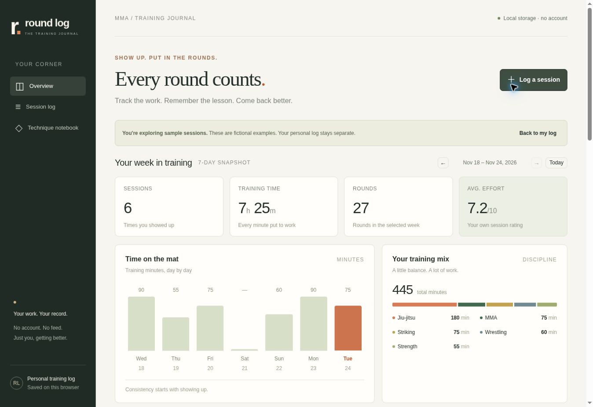

# Round Log

A small, local-first MMA training journal. Record the work you put in and the details you want to bring to your next session.



## Why this exists

Training minutes and useful lessons often end up in different places. Round Log puts session volume, rounds, and technique notes together, so a fighter can review both what they did and what they learned.

The initial product direction came from an MMA trainee who wanted **both technique notes and training volume** in one simple tracker. This first release focuses on that complete workflow. Development uses AI assistance; the source, tests, and design decisions are included for review.

## What works

- Create, edit, and delete dated sessions for MMA, jiu-jitsu, striking, wrestling, strength, and conditioning.
- Distinguish gi and no-gi jiu-jitsu while keeping combined jiu-jitsu volume.
- Record duration, completed rounds, perceived effort from 1 to 10, technique focus, lessons, and a next-session goal.
- Review a rolling seven-day snapshot: sessions, training time, rounds, average effort, daily minutes, and discipline breakdown.
- Search across notes and techniques, filter by discipline or date, and revisit the six latest matching technique notes.
- Save entries in browser `localStorage`; changes in another tab update the dashboard.
- Export the complete log to CSV or a versioned JSON backup. Import validates every record before saving, skips existing IDs, and preserves existing edits.
- Explore an explicitly labeled sample week without changing the personal log.
- Use a responsive layout with labeled fields, keyboard-accessible dialogs, visible focus, text equivalents for charts, and reduced-motion support.

## Run locally

Requires Node.js 22 or newer. There are **no runtime or npm dependencies**.

```sh
git clone https://github.com/peterkim739-source/round-log.git
cd round-log
npm start
```

Open <http://127.0.0.1:4173>. The development server binds to your own computer. To use another port:

```sh
PORT=8080 npm start
```

The app uses relative asset paths and can also be served by a static host under a subdirectory. Use an HTTP server; opening the HTML as a `file://` URL does not support ES modules consistently.

## Data and privacy

- The app does not use accounts, analytics, cookies, third-party fonts, API calls, or a backend. A hosting provider still receives ordinary requests for the app's static files.
- Training entries stay in this browser profile on this origin. They are not automatically uploaded to this repository or synchronized to another device.
- Browser storage is not encrypted. People with access to the same browser profile can access it. Clearing site data or changing origins can remove access to the log.
- **Download JSON backups regularly.** JSON is the restorable format; CSV is intended for spreadsheet analysis.
- Existing session IDs win on import. A repeated import does not create duplicates or overwrite newer local edits. Import limits are 5 MB and 10,000 sessions.
- If a saved log cannot be parsed, the app stops writes and offers the raw data for download before an explicit reset.
- Sample sessions and dashboard images are fictional examples.

See [the data model and design](docs/DESIGN.md) for date, storage, import, and export decisions.

## Validation

```sh
npm test
npm run check
```

The automated tests cover calendar and week boundaries, validation, summaries, search, duplicate imports, CSV escaping and formula handling, and storage recovery. [Browser checks](docs/TESTING.md) exercise the actual create/edit/reload/export/import workflow and mobile layout.

## Project layout

| Path | Purpose |
| --- | --- |
| `src/domain.js` | Date handling, validated records, totals, filtering, backup merging, CSV |
| `src/storage.js` | Versioned browser persistence and recovery |
| `src/app.js` | Dashboard, forms, imports, exports, and event handling |
| `styles.css` | Responsive styles without a CSS framework |
| `scripts/serve.mjs` | Dependency-free development server |
| `tests/` | Node unit tests and an optional Playwright browser check |
| `docs/` | Design decisions, limits, and verification instructions |

## Next improvements

- Add optional tags for positions, submissions, and striking combinations.
- Allow comparing two selected training periods.
- Improve keyboard and screen-reader testing across browsers.
- Explore an installable offline version with explicit cache updates.

These items are planned, not implemented. This release does not calculate readiness, give injury predictions, or recommend training loads; effort is simply the trainee's own session rating.

Contributions are welcome. See [CONTRIBUTING.md](CONTRIBUTING.md). Licensed under [MIT](LICENSE).

